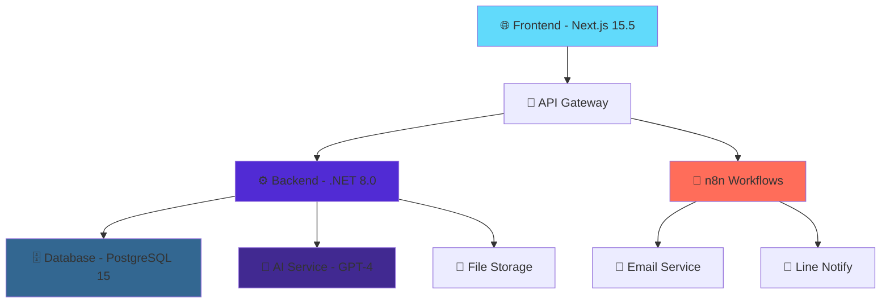
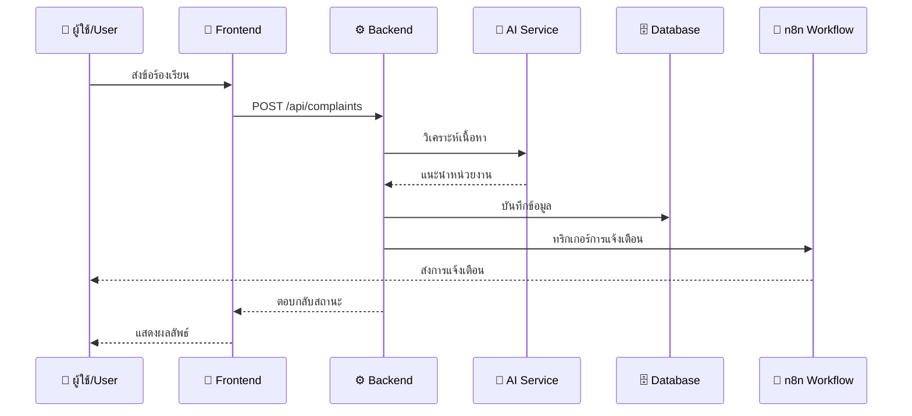
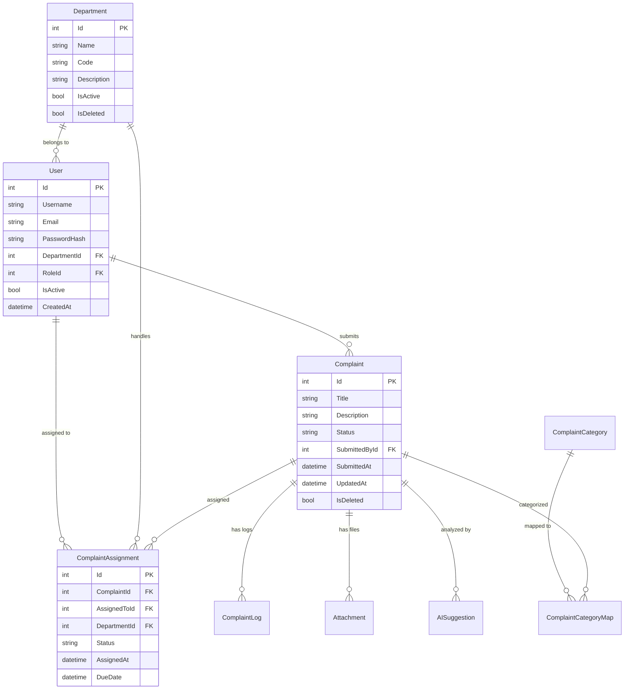

# 🚀 CMS-KPRU: ระบบจัดการข้อร้องเรียนอัจฉริยะ
### Proactive Complaint Management System with AI Integration

<div align="center">
  
  
  
  
  
  
  
</div>

<div align="center">
  <p><strong>🎓 ระบบจัดการข้อร้องเรียนด้วยปัญญาประดิษฐ์สำหรับระบบสายตรงคณบดี คณะวิทยาศาสตร์และเทคโนโลยี มหาวิทยาลัยราชภัฏกำแพงเพชร</strong></p>
  <p><em>AI-powered complaint management system for enhanced governance and transparency at Sci-Tech KPRU</em></p>
</div>

---

## � สารบัญ | Table of Contents

- [🎯 เกี่ยวกับโครงการ](#-เกี่ยวกับโครงการ)
- [✨ คุณสมบัติหลัก](#-คุณสมบัติหลัก)
- [🛠️ เทคโนโลยีที่ใช้](#️-เทคโนโลยีที่ใช้)
- [🚀 การติดตั้งและใช้งาน](#-การติดตั้งและใช้งาน)
- [📁 โครงสร้างโปรเจกต์](#-โครงสร้างโปรเจกต์)
- [🔗 API Endpoints](#-api-endpoints)
- [🤝 การมีส่วนร่วม](#-การมีส่วนร่วม)
- [📄 สิทธิ์การใช้งาน](#-สิทธิ์การใช้งาน)

## �📚 About the Project

## 🎯 เกี่ยวกับโครงการ | About the Project

ระบบ **CMS-KPRU** เป็นระบบจัดการข้อร้องเรียนที่ขับเคลื่อนด้วยปัญญาประดิษฐ์ (AI) ซึ่งได้รับการพัฒนาขึ้นเพื่อปรับปรุงและยกระดับการจัดการข้อร้องเรียนของ **คณะวิทยาศาสตร์และเทคโนโลยี มหาวิทยาลัยราชภัฏกำแพงเพชร**

**CMS-KPRU** is an innovative AI-powered complaint management system designed to revolutionize complaint handling processes at the **Faculty of Science and Technology, Kamphaeng Phet Rajabhat University (KPRU)**.

### 🎯 วัตถุประสงค์ | Project Objectives

| 🇹🇭 ภาษาไทย | 🇺🇸 English |
|-------------|-------------|
| 🤖 **ใช้ AI วิเคราะห์และจัดเส้นทางข้อร้องเรียนอัตโนมัติ** | **Automate** complaint analysis and department routing using AI |
| 🔍 **เพิ่มความโปร่งใสในกระบวนการแก้ไขข้อร้องเรียน** | **Enhance** transparency in complaint resolution processes |
| ⚡ **ปรับปรุงเวลาตอบสนองและประสิทธิภาพการบริหาร** | **Improve** response times and governance efficiency |
| 📊 **จัดให้มีระบบติดตามแบบเรียลไทม์** | **Provide** real-time tracking for all stakeholders |
| 📱 **ปรับปรุงการสื่อสารผ่านการแจ้งเตือนอัตโนมัติ** | **Streamline** communication through automated notifications |

### 🏛️ สถาบัน | Institution
**มหาวิทยาลัยราชภัฏกำแพงเพชร | Kamphaeng Phet Rajabhat University**
- 🏢 คณะวิทยาศาสตร์และเทคโนโลยี | Faculty of Science and Technology
- 📍 จังหวัดกำแพงเพชร ประเทศไทย | Kamphaeng Phet Province, Thailand
## ✨ คุณสมบัติหลัก | Key Features

### � ส่วนสำหรับประชาชน | Public Interface
- **📝 ส่งข้อร้องเรียน**: แบบฟอร์มเว็บที่ใช้งานง่ายสำหรับประชาชน  
- **🎫 ติดตามสถานะ**: ระบบ Ticket ID เฉพาะสำหรับติดตามสถานะแบบเรียลไทม์  
- **🔍 อัปเดตสถานะ**: ติดตามความคืบหนน้าการแก้ไขข้อร้องเรียนแบบสด  

### 🤖 การวิเคราะห์ด้วย AI | AI-Powered Analysis
- **📊 การจัดเส้นทางอัจฉริยะ**: AI วิเคราะห์อัตโนมัติเพื่อแนะนำหน่วยงานที่เหมาะสม  
- **📈 การจดจำรูปแบบ**: ความเข้าใจจากการเรียนรู้ของเครื่องสำหรับการจัดหมวดหมู่ข้อร้องเรียน  
- **⚡ การประมวลผลทันที**: การวิเคราะห์และจัดเส้นทางข้อร้องเรียนแบบเรียลไทม์  

### 🛡️ แดชบอร์ดสำหรับผู้บริหาร | Administrative Dashboard
- **👑 แดชบอร์ดคณบดี**: ภาพรวมผู้บริหารพร้อมการวิเคราะห์และรายงาน  
- **👥 การจัดการหน่วยงาน**: การเข้าถึงตามบทบาทสำหรับเจ้าหน้าที่และคณะกรรมการ  
- **📋 การจัดการงาน**: การมอบหมายและติดตามการแก้ไขข้อร้องเรียน  

### 🔔 การสื่อสารอัตโนมัติ | Automated Communications
- **📧 แจ้งเตือนทางอีเมล**: การอัปเดตอีเมลอัตโนมัติไปยังผู้เกี่ยวข้อง  
- **💬 การแจ้งเตือนผ่าน Line**: การแจ้งเตือนแบบเรียลไทม์ผ่านแอพ Line  
- **📱 การแจ้งเตือนหลายช่องทาง**: ระบบแจ้งเตือนที่ครอบคลุม  

### 🔐 ระบบความปลอดภัย | Security Features
- **🛡️ การยืนยันตัวตน JWT**: ระบบล็อกอินที่ปลอดภัยด้วย JSON Web Tokens  
- **� การจัดการบทบาท**: ระบบควบคุมการเข้าถึงตามบทบาทผู้ใช้  
- **🔒 การเข้ารหัสข้อมูล**: การป้องกันข้อมูลที่อ่อนไหวด้วยการเข้ารหัส  
## 🛠️ เทคโนโลยีที่ใช้ | Technology Stack

<div align="center">

| ชั้น Layer | เทคโนโลยี Technology | เวอร์ชัน Version | คำอธิบาย Description |
|------------|---------------------|------------------|---------------------|
| **Frontend** |  | 15.5.2 | Modern React framework พร้อม TypeScript และ TailwindCSS |
| **UI/UX** |  | 19.1.0 | Component-based user interface library |
| **Styling** |  | 4.0+ | Utility-first CSS framework for rapid UI development |
| **Language** |  | 5.0+ | Type-safe JavaScript for better development experience |
| **Backend** |  | 8.0 | High-performance RESTful API with authentication |
| **Database** |  | 15.0+ | Advanced relational database with JSON support |
| **ORM** |  | 9.0.8 | Modern database access technology for .NET |
| **Automation** |  | Latest | Visual workflow automation platform |
| **AI/ML** |  | GPT-4+ | Large Language Model for intelligent analysis |

</div>

### 📦 แพ็กเกจสำคัญ | Key Dependencies

**🎨 Frontend Dependencies:**
```json
{
  "next": "15.5.2",           // React framework with app router
  "react": "19.1.0",          // UI library
  "typescript": "^5",         // Type safety
  "tailwindcss": "^4",        // CSS framework
  "next-intl": "^4.3.5"       // Internationalization
}
```

**⚙️ Backend Dependencies:**
```xml
<PackageReference Include="Microsoft.EntityFrameworkCore" Version="9.0.8" />
<PackageReference Include="Npgsql.EntityFrameworkCore.PostgreSQL" Version="9.0.0" />
<PackageReference Include="System.IdentityModel.Tokens.Jwt" Version="8.14.0" />
<PackageReference Include="Swashbuckle.AspNetCore" Version="6.6.2" />
```

### 🏗️ สถาปัตยกรรมระบบ | System Architecture



### 🔄 ขั้นตอนการทำงาน | Workflow Process


## 🚀 การติดตั้งและใช้งาน | Getting Started

### 📋 สิ่งที่ต้องเตรียม | Prerequisites

ก่อนเริ่มติดตั้ง กรุณาตรวจสอบให้แน่ใจว่าคุณได้ติดตั้งซอฟต์แวร์ต่อไปนี้แล้ว:

**Before you begin, ensure you have the following installed:**

| ซอฟต์แวร์ Software | เวอร์ชัน Version | ลิงก์ดาวน์โหลด Download Link |
|-------------------|------------------|-------------------------------|
| 🔧 **.NET SDK** | 8.0+ | [dotnet.microsoft.com](https://dotnet.microsoft.com/download) |
| 📦 **Node.js** | 18 LTS+ | [nodejs.org](https://nodejs.org/) |
| 🗃️ **PostgreSQL** | 15+ | [postgresql.org](https://www.postgresql.org/download/) |
| 🔧 **Git** | Latest | [git-scm.com](https://git-scm.com/) |
| 💻 **VS Code** | Latest | [code.visualstudio.com](https://code.visualstudio.com/) |

### ⚡ การติดตั้งอย่างรวดเร็ว | Quick Installation

#### 1️⃣ **📥 โคลนโปรเจกต์ | Clone Repository**
```powershell
# Clone the repository
git clone https://github.com/hamhapichai/CMS-KPRU.git
cd CMS-KPRU
```

#### 2️⃣ **�️ ตั้งค่าฐานข้อมูล | Database Setup**

**ตัวเลือกที่ 1: ใช้ PostgreSQL ที่ติดตั้งแล้ว | Option 1: Local PostgreSQL**
```powershell
# สร้างฐานข้อมูล | Create database
createdb cmskpru_web_development

# คัดลอกไฟล์ environment | Copy environment file
cd Backend
copy .env.example .env

# แก้ไขไฟล์ .env ตามการตั้งค่าของคุณ
# Edit .env file with your database credentials
```

**ตัวเลือกที่ 2: ใช้ Docker (แนะนำ) | Option 2: Using Docker (Recommended)**
```powershell
# สร้างและเริ่ม PostgreSQL container
docker run --name cms-kpru-db -e POSTGRES_PASSWORD=postgres -e POSTGRES_DB=cmskpru_web_development -p 5432:5432 -d postgres:15
```

#### 3️⃣ **⚙️ ตั้งค่า Backend | Backend Setup**
```powershell
cd Backend

# ติดตั้ง dependencies
dotnet restore

# สร้าง migration และอัพเดตฐานข้อมูล
dotnet ef database update

# สร้างโปรเจกต์
dotnet build

# เริ่มเซิร์ฟเวอร์
dotnet run --launch-profile https
```
✅ **Backend จะทำงานที่: `https://localhost:5001`**

#### 4️⃣ **🎨 ตั้งค่า Frontend | Frontend Setup**
```powershell
# เปิด terminal ใหม่
cd Frontend/cms-kpru

# ติดตั้ง dependencies
npm install

# เริ่มเซิร์ฟเวอร์พัฒนา
npm run dev
```
✅ **Frontend จะทำงานที่: `http://localhost:3000`**

#### 5️⃣ **🔄 ตั้งค่า n8n Workflow (เพิ่มเติม) | n8n Setup (Optional)**
```powershell
# สร้าง n8n container
docker run --name cms-kpru-n8n -p 5678:5678 -v cms_kpru_n8n_data:/home/node/.n8n -d n8nio/n8n
```
✅ **n8n จะทำงานที่: `http://localhost:5678`**

### 🌟 คำสั่งสำหรับการพัฒนา | Development Commands

| คำสั่ง Command | คำอธิบาย Description | ตำแหน่ง Location |
|----------------|---------------------|-------------------|
| `dotnet watch run` | เริ่ม backend พร้อม hot reload | `/Backend` |
| `npm run dev` | เริ่ม frontend development server | `/Frontend/cms-kpru` |
| `npm run build` | สร้าง production build | `/Frontend/cms-kpru` |
| `dotnet ef migrations add <name>` | สร้าง database migration ใหม่ | `/Backend` |
| `dotnet ef database update` | อัพเดต database schema | `/Backend` |
| `npm run lint` | ตรวจสอบ code quality | `/Frontend/cms-kpru` |

### 🔧 การกำหนดค่า Environment Variables

สร้างไฟล์ `.env` ในโฟลเดอร์ `Backend/` พร้อมข้อมูลต่อไปนี้:

```env
# Database Configuration
POSTGRES_HOST=localhost
POSTGRES_PORT=5432
DB_CONNECTION_STRING=Host=localhost;Port=5432;Database=cmskpru_web_development;Username=postgres;Password=postgres
POSTGRES_USER=postgres
POSTGRES_PASSWORD=postgres

# Security
PASSWORD_SALT=your_secure_salt_here
JWT_SECRET=your_jwt_secret_key_here

# AI Service (Optional)
OPENAI_API_KEY=your_openai_api_key_here

# n8n Webhook (Optional)
N8N_WEBHOOK_URL=http://localhost:5678/webhook/complaints
```

### 🎯 การเข้าถึงระบบ | System Access

| ระบบ System | URL | คำอธิบาย Description |
|-------------|-----|---------------------|
| 🎨 **Frontend** | http://localhost:3000 | หน้าเว็บหลักและแดชบอร์ด |
| ⚙️ **Backend API** | https://localhost:5001 | RESTful API endpoints |
| 📚 **Swagger Documentation** | https://localhost:5001/swagger | API documentation |
| 🔄 **n8n Workflows** | http://localhost:5678 | Workflow automation |
| 🗄️ **Database** | localhost:5432 | PostgreSQL database |
## 📁 โครงสร้างโปรเจกต์ | Project Structure

```
CMS-KPRU/
├── 📂 Backend/                         # .NET 8.0 Web API
│   ├── 🎮 Controllers/                # API Controllers
│   │   ├── AuthController.cs          # การยืนยันตัวตน
│   │   ├── ComplaintsController.cs    # จัดการข้อร้องเรียน  
│   │   ├── DepartmentsController.cs   # จัดการหน่วยงาน
│   │   ├── UsersController.cs         # จัดการผู้ใช้
│   │   └── AISuggestionsController.cs # AI suggestions
│   ├── 📊 Models/                     # Entity Models
│   │   ├── AppDbContext.cs           # Database context
│   │   ├── User.cs                   # ผู้ใช้
│   │   ├── Complaint.cs              # ข้อร้องเรียน
│   │   ├── Department.cs             # หน่วยงาน
│   │   ├── ComplaintAssignment.cs    # การมอบหมายงาน
│   │   └── AISuggestion.cs          # ข้อแนะนำจาก AI
│   ├── 🔧 Services/                   # Business Logic
│   │   └── [Business services]       # บริการทางธุรกิจ
│   ├── 🗃️ Repositories/              # Data Access Layer  
│   │   ├── IComplaintsRepository.cs  # Interface
│   │   ├── ComplaintsRepository.cs   # Implementation
│   │   └── [Other repositories]      # อื่นๆ
│   ├── 📦 DTOs/                      # Data Transfer Objects
│   │   ├── ComplaintDto.cs           # Complaint DTO
│   │   ├── UserDto.cs                # User DTO
│   │   └── [Other DTOs]              # อื่นๆ
│   ├── 🗂️ Migrations/                # EF Core Migrations
│   │   └── [Migration files]         # ไฟล์ migration
│   ├── ⚠️ Exceptions/                # Exception Handling
│   │   ├── ExceptionMiddleware.cs    # Custom middleware
│   │   └── NotFoundException.cs      # Custom exceptions
│   ├── ⚙️ Configuration/             # Configuration
│   │   └── WebhookOptions.cs         # Webhook settings
│   ├── 📁 uploads/                   # File Storage
│   └── 📄 [Config files]             # Configuration files
├── 📂 Frontend/                       # Next.js 15.5 Application
│   └── 📱 cms-kpru/                  # Main Frontend App
│       ├── 📁 src/                   # Source Code
│       │   ├── 🎨 app/               # App Router (Next.js 13+)
│       │   │   ├── layout.tsx        # Root layout
│       │   │   ├── page.tsx          # Home page
│       │   │   ├── complaints/       # Complaint pages
│       │   │   ├── dashboard/        # Admin dashboard
│       │   │   └── user/             # User pages
│       │   ├── 🧩 components/        # Reusable Components
│       │   │   ├── ui/               # UI components
│       │   │   ├── forms/            # Form components
│       │   │   └── layout/           # Layout components
│       │   ├── 🔧 utils/             # Utility Functions
│       │   └── 📝 types/             # TypeScript Types
│       ├── 🎨 public/                # Static Assets
│       ├── ⚙️ tailwind.config.ts     # TailwindCSS config
│       ├── 📦 package.json           # Dependencies
│       └── 🔧 next.config.js         # Next.js configuration
├── 📂 n8n/                           # Workflow Automation
│   ├── kpru-cms.json                # Main workflow
│   └── kpru-cms-updated.json        # Updated workflow
├── 📄 CMS-KPRU.sln                   # Visual Studio Solution
├── 🐳 docker-compose.yml             # Container Orchestration  
├── � README.md                      # Project Documentation
└── 🧪 test-upload.html              # Testing file
```

### � ความสัมพันธ์ของฐานข้อมูล | Database Relationships



## � API Endpoints

### 🔐 การยืนยันตัวตน | Authentication
```http
POST   /api/auth/login          # เข้าสู่ระบบ | User login
POST   /api/auth/register       # ลงทะเบียนผู้ใช้ | User registration  
POST   /api/auth/refresh        # รีเฟรช JWT token | Refresh JWT token
POST   /api/auth/logout         # ออกจากระบบ | User logout
```

### 📝 การจัดการข้อร้องเรียน | Complaints Management
```http
GET    /api/complaints          # รายการข้อร้องเรียนทั้งหมด | List all complaints
POST   /api/complaints          # ส่งข้อร้องเรียนใหม่ | Submit new complaint
GET    /api/complaints/{id}     # รายละเอียดข้อร้องเรียน | Get complaint details  
PUT    /api/complaints/{id}     # อัพเดตสถานะข้อร้องเรียน | Update complaint status
DELETE /api/complaints/{id}     # ลบข้อร้องเรียน | Delete complaint
GET    /api/complaints/{id}/history # ประวัติการเปลี่ยนแปลง | Complaint history
```

### 🤖 AI Suggestions
```http
POST   /api/ai-suggestions      # ขอคำแนะนำจาก AI | Get AI department suggestions
GET    /api/ai-suggestions/{id} # รายละเอียดคำแนะนำ | Get suggestion details
POST   /api/ai-suggestions/{id}/approve # อนุมัติคำแนะนำ | Approve suggestion
```

### 🏢 การจัดการหน่วยงาน | Departments Management  
```http
GET    /api/departments         # รายการหน่วยงาน | List all departments
POST   /api/departments         # สร้างหน่วยงานใหม่ | Create new department
GET    /api/departments/{id}    # รายละเอียดหน่วยงาน | Get department details
PUT    /api/departments/{id}    # อัพเดตข้อมูลหน่วยงาน | Update department
DELETE /api/departments/{id}    # ลบหน่วยงาน | Delete department
```

### 👥 การจัดการผู้ใช้ | Users Management
```http
GET    /api/users               # รายการผู้ใช้ | List all users
POST   /api/users               # สร้างผู้ใช้ใหม่ | Create new user
GET    /api/users/{id}          # รายละเอียดผู้ใช้ | Get user details
PUT    /api/users/{id}          # อัพเดตข้อมูลผู้ใช้ | Update user
DELETE /api/users/{id}          # ลบผู้ใช้ | Delete user
GET    /api/users/profile       # โปรไฟล์ผู้ใช้ปัจจุบัน | Current user profile
```

### 👑 การจัดการบทบาท | Roles Management
```http
GET    /api/roles               # รายการบทบาท | List all roles
POST   /api/roles               # สร้างบทบาทใหม่ | Create new role
GET    /api/roles/{id}          # รายละเอียดบทบาท | Get role details
PUT    /api/roles/{id}          # อัพเดตบทบาท | Update role
DELETE /api/roles/{id}          # ลบบทบาท | Delete role
```

### 📊 รายงานและสถิติ | Reports & Analytics
```http
GET    /api/reports/dashboard   # ข้อมูลแดชบอร์ด | Dashboard data
GET    /api/reports/statistics  # สถิติข้อร้องเรียน | Complaint statistics  
GET    /api/reports/trends      # แนวโน้มข้อร้องเรียน | Complaint trends
GET    /api/reports/departments # รายงานตามหน่วยงาน | Department reports
```

### 📎 การจัดการไฟล์ | File Management
```http
POST   /api/files/upload        # อัพโหลดไฟล์ | Upload file
GET    /api/files/{id}          # ดาวน์โหลดไฟล์ | Download file
DELETE /api/files/{id}          # ลบไฟล์ | Delete file
```

### 🔔 การแจ้งเตือน | Notifications
```http
GET    /api/notifications       # รายการการแจ้งเตือน | List notifications
POST   /api/notifications/mark-read/{id} # ทำเครื่องหมายอ่านแล้ว | Mark as read
POST   /api/notifications/mark-all-read # ทำเครื่องหมายอ่านทั้งหมด | Mark all as read
```

### 📋 ตัวอย่างการเรียก API | API Usage Examples

**🔐 การเข้าสู่ระบบ | Login Example:**
```http
POST /api/auth/login
Content-Type: application/json

{
  "username": "admin@kpru.ac.th",
  "password": "your_password"
}
```

**📝 การส่งข้อร้องเรียน | Submit Complaint Example:**
```http
POST /api/complaints  
Content-Type: application/json
Authorization: Bearer {your_jwt_token}

{
  "title": "ปัญหาเกี่ยวกับระบบลงทะเบียน",
  "description": "ระบบลงทะเบียนออนไลน์ล่มบ่อย ทำให้นักศึกษาไม่สามารถลงทะเบียนได้",
  "category": "IT",
  "priority": "High",
  "attachments": [
    {
      "fileName": "screenshot.png",
      "fileData": "base64_encoded_data"
    }
  ]
}
```

**📊 การขอข้อมูลสถิติ | Get Statistics Example:**
```http
GET /api/reports/statistics?startDate=2025-01-01&endDate=2025-12-31
Authorization: Bearer {your_jwt_token}
```

## 🤝 การมีส่วนร่วม | Contributing

เรายินดีต้อนรับการมีส่วนร่วมจากนักพัฒนาทุกท่าน! กรุณาทำตามขั้นตอนต่อไปนี้:

**We welcome contributions from all developers! Please follow these steps:**

### 📋 ขั้นตอนการ Contribute | Contribution Steps

1. **🍴 Fork โปรเจกต์ | Fork the repository**
   ```bash
   # คลิกปุ่ม Fork บน GitHub หรือ
   gh repo fork hamhapichai/CMS-KPRU
   ```

2. **🌿 สร้าง Feature Branch | Create a feature branch**
   ```bash
   git checkout -b feature/amazing-feature
   ```

3. **💾 Commit การเปลี่ยนแปลง | Commit your changes**
   ```bash
   git add .
   git commit -m "Add amazing feature: รายละเอียดฟีเจอร์ใหม่"
   ```

4. **📤 Push ไปที่ Branch | Push to the branch**
   ```bash
   git push origin feature/amazing-feature
   ```

5. **🔄 เปิด Pull Request | Open a Pull Request**

### 📝 มาตรฐานการเขียนโค้ด | Coding Standards

**🎯 Backend (.NET):**
- ใช้ **C# Coding Conventions** ตามมาตรฐาน Microsoft
- เขียน **Unit Tests** สำหรับฟีเจอร์ใหม่
- ใช้ **async/await** สำหรับการทำงานแบบ asynchronous
- ตั้งชื่อตัวแปรและฟังก์ชันให้สื่อความหมาย

**🎨 Frontend (Next.js):**
- ใช้ **TypeScript** อย่างเข้มงวด
- ติดตั้งและใช้ **ESLint** + **Prettier**
- ใช้ **TailwindCSS** สำหรับ styling
- สร้าง **Component** ที่ reusable

**🗄️ Database:**
- ใช้ **Entity Framework Migrations** สำหรับการเปลี่ยนแปลง schema
- เขียน **Seed Data** สำหรับข้อมูลเริ่มต้น
- ตั้งชื่อตาราง และคอลัมน์ให้เป็นมาตรฐาน

### 🧪 การทดสอบ | Testing

**📱 Frontend Testing:**
```bash
cd Frontend/cms-kpru
npm run test        # Run unit tests
npm run lint        # Check code quality
npm run build       # Test production build
```

**⚙️ Backend Testing:**
```bash
cd Backend
dotnet test         # Run unit tests
dotnet format       # Format code
dotnet build        # Build project
```

### 📚 การเขียน Documentation

- อัพเดต **README.md** หากเพิ่มฟีเจอร์ใหม่
- เขียน **XML Comments** สำหรับ public methods
- อัพเดต **API Documentation** ใน Swagger
- เพิ่ม **Example Usage** ถ้าจำเป็น

### 🐛 การรายงานบัก | Bug Reports

เมื่อพบบัก กรุณาสร้าง Issue โดยระบุ:

1. **📝 คำอธิบายปัญหา** | Problem Description
2. **🔄 ขั้นตอนการทำ** | Steps to Reproduce  
3. **✅ ผลลัพธ์ที่คาดหวัง** | Expected Result
4. **❌ ผลลัพธ์ที่เกิดขึ้น** | Actual Result
5. **💻 สภาพแวดล้อม** | Environment Details

### 💡 การขอฟีเจอร์ใหม่ | Feature Requests

สำหรับฟีเจอร์ใหม่ กรุณาระบุ:

1. **🎯 วัตถุประสงค์** | Purpose/Goal
2. **👤 ผู้ใช้กลุ่มเป้าหมาย** | Target Users
3. **✨ รายละเอียดฟีเจอร์** | Feature Details
4. **🔄 Alternative Solutions** | แนวทางอื่นที่เคยพิจารณา

### 👨‍💻 ทีมพัฒนา | Development Team

| บทบาท Role | ชื่อ Name | ติดต่อ Contact |
|------------|-----------|----------------|
| **🎯 Project Lead** | Apichai Butdee | [@hamhapichai](https://github.com/hamhapichai) |
| **🎓 Academic Advisor** | Assoc. Prof. Dr. Bhoomin Tanut | KPRU Faculty |
| **💻 Contributors** | Open for Contributors | Welcome! |

## 🐛 การแก้ปัญหา | Troubleshooting

### ❗ ปัญหาที่พบบ่อย | Common Issues

#### 🗄️ **ปัญหาการเชื่อมต่อฐานข้อมูล | Database Connection Issues**

**🔍 ตรวจสอบ:**
```powershell
# ตรวจสอบว่า PostgreSQL ทำงานหรือไม่
Get-Process postgres
# หรือ
docker ps | findstr postgres

# ทดสอบการเชื่อมต่อ
psql -h localhost -p 5432 -U postgres -d cmskpru_web_development
```

**🔧 แก้ไข:**
```powershell
# รีสตาร์ท PostgreSQL (Docker)
docker restart cms-kpru-db

# รีเซ็ตฐานข้อมูล
cd Backend
dotnet ef database drop --force
dotnet ef database update
```

#### 🎨 **ปัญหา Frontend Build Error**

**🔍 อาการ:** `npm run build` หรือ `npm run dev` error

**🔧 แก้ไข:**
```powershell
cd Frontend/cms-kpru

# ลบ cache และ reinstall
Remove-Item -Recurse -Force node_modules, .next, package-lock.json
npm install

# หรือใช้ npm cache clean
npm cache clean --force
npm install
```

#### ⚙️ **ปัญหา Backend API ไม่ทำงาน | Backend API Not Starting**

**🔍 ตรวจสอบ Port:**
```powershell
# ตรวจสอบว่า port 5001 ถูกใช้หรือไม่
netstat -ano | findstr :5001

# หรือใช้ PowerShell
Get-NetTCPConnection -LocalPort 5001
```

**🔧 แก้ไข:**
```powershell
cd Backend

# ล้างและ restore packages
dotnet clean
dotnet restore
dotnet build

# เช็ค configuration
dotnet run --launch-profile Development
```

#### 🔒 **ปัญหา HTTPS Certificate**

**🔍 อาการ:** เบราว์เซอร์แจ้งเตือน certificate error

**🔧 แก้ไข:**
```powershell
# สร้าง development certificate ใหม่
dotnet dev-certs https --clean
dotnet dev-certs https --trust

# สำหรับ PowerShell
dotnet dev-certs https -ep "$env:USERPROFILE\.aspnet\https\aspnetapp.pfx" -p password
```

#### 🤖 **ปัญหา AI Service ไม่ทำงาน**

**🔍 ตรวจสอบ:** API key และ configuration

**🔧 แก้ไข:**
```bash
# ตรวจสอบ environment variables
echo $OPENAI_API_KEY
# หรือใน PowerShell
$env:OPENAI_API_KEY
```

### 🔧 เครื่องมือ Debug | Debug Tools

#### 📊 **Database Debugging:**
```sql
-- ตรวจสอบตารางในฐานข้อมูล
\dt

-- ตรวจสอบข้อมูล complaints
SELECT * FROM "Complaints" ORDER BY "SubmittedAt" DESC LIMIT 10;

-- ตรวจสอบ connection string
SHOW all;
```

#### 🌐 **API Debugging:**
```http
# ทดสอบ API health check
GET https://localhost:5001/api/health

# ดู Swagger documentation  
GET https://localhost:5001/swagger
```

#### 📱 **Frontend Debugging:**
```powershell
# ดูเวอร์ชัน dependencies
npm list

# ตรวจสอบ TypeScript errors
npm run type-check

# ดู build logs
npm run build -- --verbose
```

### 📋 Logs และการ Monitor | Logs & Monitoring

#### ⚙️ **Backend Logs:**
```powershell
# ดู application logs
cd Backend
dotnet run --verbosity normal

# หรือใช้ structured logging
dotnet run --configuration Development
```

#### 🎨 **Frontend Logs:**
```powershell
# Development server logs  
npm run dev -- --verbose

# Build process logs
npm run build -- --debug
```

#### 🐳 **Docker Logs:**
```powershell
# ดู PostgreSQL logs
docker logs cms-kpru-db

# ดู n8n logs
docker logs cms-kpru-n8n -f
```

### 🆘 ขอความช่วยเหลือ | Getting Help

หากยังแก้ปัญหาไม่ได้ สามารถขอความช่วยเหลือได้ที่:

1. **📝 สร้าง GitHub Issue:** [New Issue](https://github.com/hamhapichai/CMS-KPRU/issues/new)
2. **💬 ติดต่อทีมพัฒนา:** [@hamhapichai](https://github.com/hamhapichai)
3. **📧 อีเมล:** apichai.butdee@example.com

**📋 ข้อมูลที่ควรระบุเมื่อขอความช่วยเหลือ:**
- 🖥️ ระบบปฏิบัติการ (Windows/macOS/Linux)
- 📦 เวอร์ชัน .NET SDK (`dotnet --version`)
- 📦 เวอร์ชัน Node.js (`node --version`)
- 📄 Error message ที่เกิดขึ้น (Screenshot หรือ Text)
- 🔄 ขั้นตอนที่ทำก่อนเกิดปัญหา

## 📄 สิทธิ์การใช้งาน | License

โครงการนี้ได้รับอนุญาตภายใต้ **MIT License** - ดูรายละเอียดได้ที่ไฟล์ [LICENSE](LICENSE)

**This project is licensed under the MIT License** - see the [LICENSE](LICENSE) file for details.

### 🔓 MIT License Summary

✅ **อนุญาต | Permissions:**
- ✔️ การใช้งานเชิงพาณิชย์ | Commercial use
- ✔️ การปรับเปลี่ยน | Modification  
- ✔️ การแจกจ่าย | Distribution
- ✔️ การใช้งานส่วนตัว | Private use

❌ **ข้อจำกัด | Limitations:**
- ❌ ไม่รับประกัน | No warranty
- ❌ ไม่รับผิดชอบ | No liability

📋 **เงื่อนไข | Conditions:**
- ☑️ ต้องรวม license และ copyright notice

---

## 🏆 กิตติกรรมประกาศ | Acknowledgments

### 🎓 **สถาบันการศึกษา | Academic Institution**
- **🏛️ มหาวิทยาลัยราชภัฏกำแพงเพชร** สำหรับการสนับสนุนโครงการ
- **🔬 คณะวิทยาศาสตร์และเทคโนโลยี** สำหรับการให้คำปรึกษาและทรัพยากร
- **Faculty of Science and Technology, KPRU** for project support and guidance

### 👨‍🏫 **ที่ปรึกษาโครงการ | Project Advisors**
- **Assoc. Prof. Dr. Bhoomin Tanut** - *Academic Supervision & Research Guidance*
- **อาจารย์ที่ปรึกษา** - *การให้คำแนะนำด้านวิชาการและการวิจัย*

### 🛠️ **เครื่องมือและเทคโนโลยี | Tools & Technologies**
- **🔓 Open Source Community** สำหรับเครื่องมือและ libraries ที่ยอดเยี่ยม
- **📚 .NET Foundation** สำหรับ ASP.NET Core framework
- **⚛️ Vercel Team** สำหรับ Next.js framework
- **🐘 PostgreSQL Global Development Group** สำหรับฐานข้อมูลที่เสถียร
- **🎨 Tailwind Labs** สำหรับ TailwindCSS framework

### 🌟 **Special Thanks**
- **💻 Microsoft** สำหรับ Visual Studio และ development tools
- **🐙 GitHub** สำหรับ platform การพัฒนาและ collaboration
- **🤖 OpenAI** สำหรับ AI/ML capabilities
- **🔄 n8n Community** สำหรับ workflow automation platform

### 🤝 **Contributors**
ขอขอบคุณนักพัฒนาและผู้ร่วมงานทุกท่านที่ช่วยปรับปรุงโครงการนี้:

**Thank you to all contributors who help improve this project:**

<div align="center">
  <a href="https://github.com/hamhapichai/CMS-KPRU/graphs/contributors">
    
  </a>
</div>

---

<div align="center">
  <h3>🎯 Project Status</h3>
  <p>
    
    
    
  </p>
</div>

<div align="center">
  <h3>💝 Made with Love</h3>
  <p>
    <strong>🎓 Developed by KPRU Development Team</strong><br>
    <em>สร้างด้วยความตั้งใจเพื่อพัฒนาการบริหารจัดการที่ดีขึ้น</em><br>
    <em>Built with dedication for better governance and transparency</em>
  </p>
  
  <p>
    <strong>⭐ ถ้าโครงการนี้มีประโยชน์ กรุณา Star Repository นี้!</strong><br>
    <strong>⭐ If you find this project helpful, please star this repository!</strong>
  </p>
  
  <p>
    <a href="https://github.com/hamhapichai/CMS-KPRU/stargazers">
      
    </a>
    <a href="https://github.com/hamhapichai/CMS-KPRU/network/members">
      
    </a>
  </p>
</div>

---

<div align="center">
  <h3>🔝 <a href="#cms-kpru-ระบบจัดการข้อร้องเรียนอัจฉริยะ">Back to Top</a></h3>
</div>

---

<div align="center">
  <p><em>© 2025 CMS-KPRU Project. All rights reserved.</em></p>
  <p><em>Kamphaeng Phet Rajabhat University | มหาวิทยาลัยราชภัฏกำแพงเพชร</em></p>
</div>
